# Cedar / Maple 示例整理与演示交付

日期：2026-10-23。

## 最新收尾状态（当晚，优先于下文历史记录）

已修复上一轮确认的案例错误，并补齐 Dialog、Scheduler、Time、DropdownMenu 的遗留页面／源码检查。**当前不能宣布整个工作区最终验收通过**：收尾期间 Maple 的 `src/dropdown-menu` 正在被另一项改动迁移为 `src/menu`，开发服务生成的 `.maple/pc.routes.ts` 仍引用已不存在的 `dropdown-menu/docs/en-US.md`，浏览器实际显示 Vite import-analysis 错误。未擅自恢复旧目录、添加旧 API 兼容层或覆盖这次迁移。

本节记录已经完成并留证的修复；待迁移同步完成后，需要重新生成路由并做最后的手势专项及全库检查。页面覆盖数字是逐次巡检的累计记录，不代表并行重构后的当前版本全绿。

### 已完成的修复

| 范围 | 改动及实测结果 |
| --- | --- |
| 双端 Space / 组合布局 | 统一公开方向 `row/column`，修正误写的 `vertical`；横向对比显式换行。首轮机械修正 109 份 SFC，新增契约检查及 2 项测试。不是全局隐藏 overflow。 |
| Maple 窄屏 | Checkbox、Radio、Rate、Tag、菜单、Tooltip、Icon、Pagination、Ripple、ProgressGroup 复验手机宽度和滚动宽度均为 346px；亮暗均留证。分页额外修正 Grid 的最小列宽；图标搜索框取消 `width:100% + 左右 margin` 的叠加；环形进度尺寸限制为容器内可比较的尺寸并换行；长动效按钮允许多行。 |
| Cedar 组合布局 | Segmented 五档尺寸不再误排成一条横向 Space；Pagination 和 ProgressGroup 同步采用防撑宽布局。Segmented 页面亮暗无 demo 溢出。 |
| Map | 删除未初始化的 fetch、未定义的 base64ToString、失效凭据流程及远端占位定位图，替换为内联图标。无 SDK 时禁用搜索并明确提示，不请求真实定位；北京／上海本地位置切换及重置实际通过，首例源码一致。未承诺真实 SDK 已接通。 |
| Table | 基础案例直接展示三列三行数据；空数据独立为 empty-state.vue。清除六个空 Tabs 和无效 default-active-key。实页显示三行和独立空态，两个案例源码均一致。 |
| Textarea | 两端首例均展示 v-model、default-value、v-model.trim；中英文说明与案例一致。实际输入更新受控文本、默认值存在、失焦去除空白，亮暗均通过，首例源码一致。 |
| 文档组织 | Checkbox、Radio 基础案例优先；区分原生控件和自定义控件插槽；补 FormDetails、HighlighterProvider、LocaleProvider 中英文一级标题与导语。整理器识别基本使用及多行 app-type 结束标签，避免丢标题。 |
| 源码引用门禁 | 整理器只添加实际存在的示例，不再生成悬空的英文 Button round/stacked 引用；共享检查区分其他组件拥有的引用示例和本组件案例，未放宽本地案例的完整性检查。 |
| Maple 聚合入口 | 修复聚合默认对象立即读取组件造成的 `Cannot access 'Image' before initialization` 风险，改为保留 ESM live binding 的 getter；入口生成器同步修正，循环依赖加载回归通过。 |
| Maple 开发重启 | 配置变更重启改为串行队列，避免 watcher 同时创建多个服务；2 项测试覆盖并发变更和失败后恢复。站点显式声明默认／枫叶两套亮暗菜单选项，避免只依赖 CLI 默认配置。 |

### 补齐的实际浏览器操作

- Cedar Dialog：亮暗分别打开真实 Dialog，点击取消后确认弹层隐藏；首例展开源码与 basic.vue 一致。
- Cedar Scheduler：亮暗分别确认网格与事件卡片真实渲染；下一页改变日期、上一页恢复；新建打开编辑器、取消关闭。另实际填标题并保存，网格出现“巡检新增日程”卡片，不仅检查外框。
- Cedar Time、DropdownMenu：重新展开当前首例源码，均与实际引用的 SFC 一致。DropdownMenu 的结果是在随后 Menu 改名之前取得，改名后的路由仍需验收。
- Maple Checkbox、Radio：基础案例顺序与标题已对齐；亮暗手机预览不再撑宽。Rate 的无文字图标 DOM 已实际存在，不能把 `innerText === ''` 当成空案例。
- Badge、TabBar 有徽标绝对定位越出自身盒子的几何命中，但手机整页仍为 346px；与整个页面被撑宽区分，不为消除统计值裁剪徽标。Upload 使用 h3 而非 AppType 标题，空的 AppType 列表不代表案例没渲染。

原始补验：[validation.json](./evidence/demo-reorganization-2026-10-23/fixes/validation.json)。对应截图位于同一 fixes 目录。旧失败和超时记录保留，不覆盖成成功。

### 本轮验证及边界

- 全量 SFC 编译：2,857 个通过；文档引用：2,879 个通过，无缺失（Menu 迁移前的检查结果）。
- 双端共享案例：121 对通过，含 22 次站点 Markdown 转换和 11 份完整 API 表。
- 布局／整理器回归：10 项通过；入口循环依赖回归：1 项通过；开发重启队列：2 项通过。
- Maple 手势与生命周期回归：19 个文件的 176 项通过；另一 SwipeCell 文件首次遇到模块 fetch 超时，单独重跑 5 项通过，共 181 项。覆盖 SwipeCell、Drag、PullRefresh、Signature、Ripple、InfiniteScroll、Lazy、Hover；这是组件挂载及事件测试，不是真机触摸认证。
- Cedar Map：原有 7 项通过，并新增本地位置示例操作测试 1 项通过；Map 快照因内联 SVG 和禁用降级态更新。
- Cedar Dialog：19 项通过；Scheduler：30 项通过。Scheduler 旧快照的唯一变化是选择器文字新增 `c-selection-field__label` 类，已核对差异后更新，无行为断言删除。
- Maple 全库 lint、Cedar / Maple 类型检查均有通过记录。期间两端 Breadcrumb 原生 lostpointercapture 的声明差异由当前工作区同步调整后，重新检查通过；不是忽略类型错误。
- 未在浏览器巡检期间执行会删除 es/lib 产物的全库构建。没有把更早批次的 550 场景结果当作本轮重跑结果。

### 当前阻塞与准确的待处理项

1. **先完成正在并行进行的 Menu 迁移**：目录、组件名、根导出、文档、组件复用清单、自动生成路由要指向同一新名称；只保留最终 API，不恢复旧别名。然后以单一开发实例重新生成并打开两端 Menu 页面。本轮未修改另一项迁移的组件设计。
2. **稳定后补实际浏览器专项**：SwipeCell 暗色侧滑并点击操作、Drag 拖动位置、Signature 绘制／清空、PullRefresh 真实触摸下拉、Hover 指针进出、InfiniteScroll 滚动加载、Lazy 进入视区、Upload 本地队列取消／重试。已有单元回归不能替代这些尚未完成的实页操作。
3. **外部集成需业务环境**：真实地图 SDK、真实上传服务器及权限策略没有配置，不应在组件演示中硬编码凭据或上传个人文件。本轮实现的是明确降级和本地可控示例，不是第三方服务联调。
4. **最后再跑一次统一门禁**：SFC／路径、共享案例、布局契约、lint、两端类型检查和受影响测试。当前 organizer 仍发现 Button、Divider、Icon 的并行新增文档有 6 处顺序差异，未在迁移过程中反复覆盖另一项工作的文件。

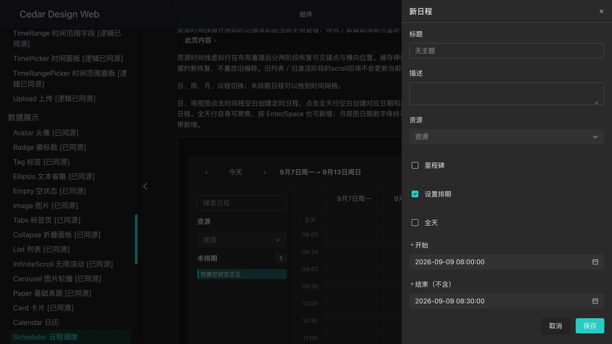
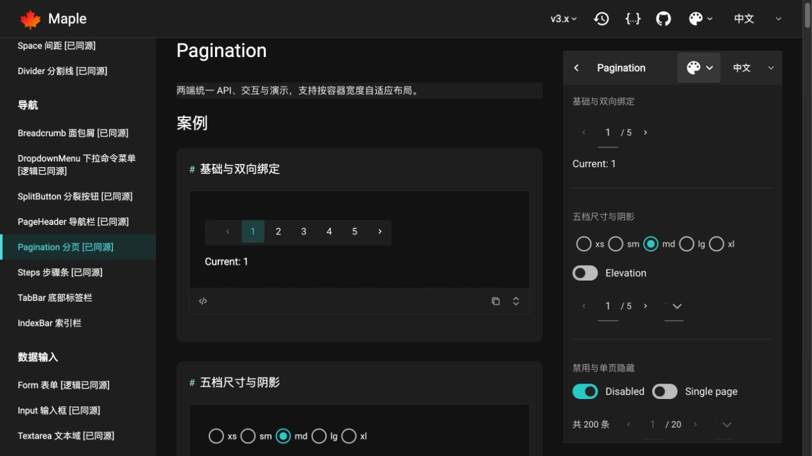

下方为此前批次的历史记录，具体未完成项以本节为准。

## 整理结果

两库采用相同的示例组织规则：同类功能一起比较，每个案例最多组合三个相关维度，基础功能在前、复杂场景在后、功能调试最后。已整理 271 份中英文文档及对应的 Maple 示例集合；文档、实际运行文件和源码展示保持同源。

新增 40 组双端案例，共 80 个独立 SFC，覆盖 30 个共同组件。这一数量不包含拆分原有大案例产生的文件。完整清单见 [新增案例清单](./demo-enrichment-2026-10-23.json)。

新增案例覆盖 Input、Textarea、InputNumber、Select、AutoComplete、Cascader、Checkbox、Radio、Switch、Slider、Rate、日期时间、VerificationCode、Upload、Form，以及 Alert、Badge、Card、Message、Steps、SplitButton、Tabs、Tag、Tooltip、Row、Space 等组件。每个案例补充适用场景、操作方法和观察目标，使用本地示例数据。

## 重点改动

| 组件或范围 | 最终组织 |
| --- | --- |
| Button | 变体、状态、尺寸合为一个对比案例；加载动画、布局、尺寸合为一个案例；水波与阴影同组；加载颜色与半径同组 |
| ButtonGroup | 分为继承覆盖、布局、图文与加载三类；去掉原来一张卡片同时展示数十个按钮的组织方式 |
| Select | 去掉两种外观各重复十四个选择框；按绑定值、状态、清除、图标、多选、数据、字段映射组织；Cedar 基础案例不再把字符串单选和数组多选绑到同一个值 |
| Form | 原三十种控件加异步控制的大案例改为文本、勾选、下拉、层级、日期、时间、评分、附件等类别；字段展示只保留继承与局部覆盖，异步确认缩减至三个字段和三个控制维度，跨页日期边界独立展示 |
| 功能调试 | 188 个入口、550 个场景共用功能分类；每次最多显示三个控制项，切换时清除旧覆盖和事件记录 |
| 说明与引用 | 同步中英文标题、独立集合、文档顺序及可复制源码；补齐 Switch 已有字段展示属性表 |

参考了本地 Element Plus Button 的同类对比方式，以及 Naive UI 的独立加载交互和禁用示例。公共约定已写入 [示例设计规范](../standards/demo-design.md)，并接入两库组件开发规范。

26 份页面开头的内部排查、授权和验证历史已保留到 [维护记录归档](./evidence/demo-reorganization-2026-10-23/maintenance-notes.json)，避免挤在功能说明之前。

## 验证结果

| 检查 | 结果 |
| --- | --- |
| 全量示例 SFC 编译 | 2,852 个通过 |
| 文档示例路径 | 2,853 个引用检查通过，无缺失文件 |
| 全库功能调试运行回归 | Cedar 296、Maple 254，共 550 个场景通过 |
| 新增及重点调整案例 | 127 项真实组件挂载和属性切换测试通过 |
| 共享调试区 | 28 项测试通过，包括分类、提交与重置 |
| 双端共享案例 | 122 对通过，含顺序、中英文引用、源码编译、22 次站点 Markdown 转换及 11 份公共 API 表检查 |
| 类型检查 | Cedar、Maple 通过；修正了 Steps 新案例重复指定 status 的问题 |
| Maple 全库只读 lint | 通过 |

运行记录见 [全库场景结果](./evidence/demo-reorganization-2026-10-23/runtime.json)。编译与运行检查命令：

```sh
node design-ui/bin/demo-design-check.mjs
node design-ui/bin/organize-demo-pages.mjs
node design-ui/bin/review-demos-check.mjs
node design-ui/bin/same-source-demos-check.mjs
```

浏览器已检查两库 Button 文档页面及外观选择器；两端的 outline 切换和暗色页面展示正常，Maple 右侧独立示例集合的标题与文档一致。自动运行回归采用真实组件加 JSDOM，不代表每种浏览器、触摸手势和全部视觉排列均逐一人工验收。地图 SDK 和真实上传接口仍需要业务环境，本轮表单附件案例关闭自动上传。

## 下午演示入口

- [Cedar Button](http://127.0.0.1:9991/components/button/)
- [Cedar Select](http://127.0.0.1:9991/components/select/)
- [Cedar Form](http://127.0.0.1:9991/components/form/)
- [Maple Button](http://localhost:8082/#/zh-CN/button)
- [Maple Select](http://localhost:8082/#/zh-CN/select)
- [Maple Form](http://localhost:8082/#/zh-CN/form)

建议按 Button 外观三维对比 → 加载布局 → Input / Select 状态 → Tabs → Form 分类字段的顺序展示。本次浏览器复查时 8080、8081 均已被占用，新启动的 Maple 服务在 8082；Cedar 使用 9991，未启用 9992。

## 实际浏览器复查（2026-10-23 下午）

本节是本次浏览器操作结果，上文全量统计是此前自动化回归结果，不代表本次逐个点击了全部案例。

| 检查项 | 实际结果 |
| --- | --- |
| 亮色 / 暗色 | 两站均实际切换并查看；Maple 网站、卡片和右侧移动预览同步变色，Cedar 卡片和源码区可读 |
| Tabs | 两端最简案例均显示三个标题；点击“详情”显示“详情内容”，高亮正常。Maple 展开源码确认是 `mp-tab-pane + title` |
| Select | Maple 基础下拉选“睡觉”后收起、回填，清空恢复；展开源码为同一基础案例。Cedar 基础下拉选择 Shanghai 后收起 |
| Form | Maple 点击提交显示“通过”，重置显示“已重置”并清空模型；Cedar 字段展示案例点击提交显示“表单已提交”，展开源码文件为 field-presentation.vue |
| Button | Maple 切换 outline，异步 Resolve / Reject 均先禁用阻止重复点击，完成后分别显示 loading released 并恢复可用 |
| 浏览器错误 | Maple 检查时无 error 日志。Cedar 开发服务曾出现 VuePress 页面数据 HMR 的 undefined.path 错误；刷新后页面及表单交互正常，日志未出现新的同类记录，未根治开发工具问题 |

### 本轮修复

Maple 移动预览中账号 / 密码自动填充后，浮动提示与浏览器画出的值重叠。原因是浏览器可在 Vue 模型尚未更新时先绘制自动填充值。Cedar / Maple 的 FieldDecorator 均补上 `:has(input:autofill)`：提示上移并打开 outline 缺口，不改公开 API、不读取凭据。已在 Maple 亮暗色截图中复验重叠消失。此修复只处理视觉状态，不新增自动填充的数据同步协议。

增加两端 CSS 契约回归；JSDOM 无法模拟真实密码管理器自动填充，因此实际浏览器复验仍是关键证据。

本轮验证：Cedar FieldDecorator 4 项通过；Maple FieldDecorator 3 项及契约 4 项通过；Maple 全库 `lint:check` 通过；本轮修改文件 `git diff --check` 通过。Maple 首次命令误用了旧版 `--threads` 参数，已换成 Vitest 3 的单 worker 参数重新运行通过。本轮没有重复执行上文全库类型检查及 550 场景回归。

### 首轮复查发现的问题 / 演示注意

- 首轮发现 Cedar Select / Form 的部分复杂案例仍在基础案例前，Maple Form 首屏有内部工程修复说明。**已在下方“文档与热更新收尾”中处理**。
- 文档冷启动和首次跳转较慢，建议演示前预先打开 Button、Tabs、Select、Form，不在台上重启服务。
- 本次是重点页面抽查，不包含所有案例、所有尺寸、真实手机触摸、Safari、地图 SDK、真实上传接口的完整验收；两套品牌色的所有组合也未逐一点击。
- 页面仍可能被本机密码管理器自动填充；建议演示使用不带个人凭据的浏览器配置。

### 修复后截图

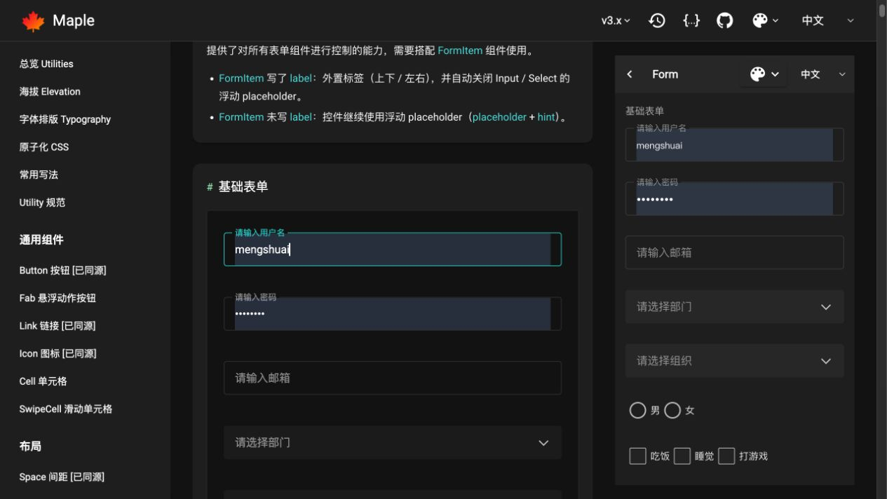
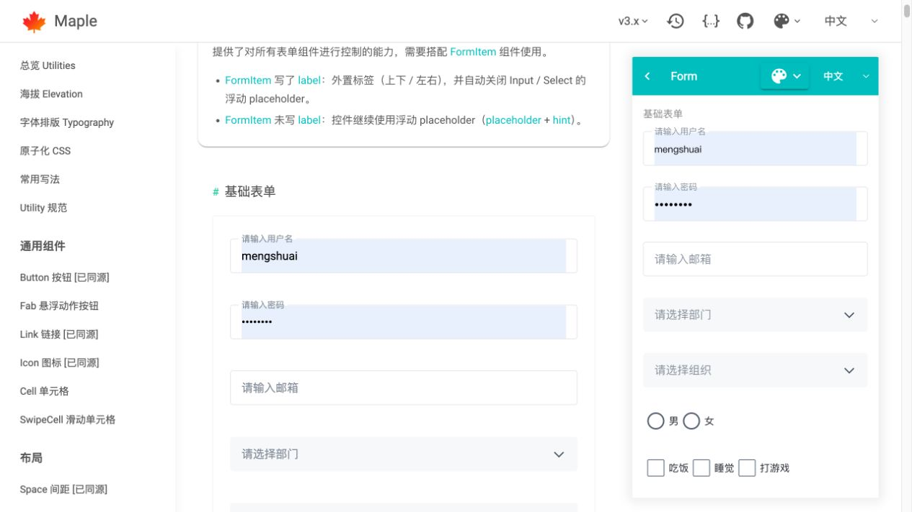
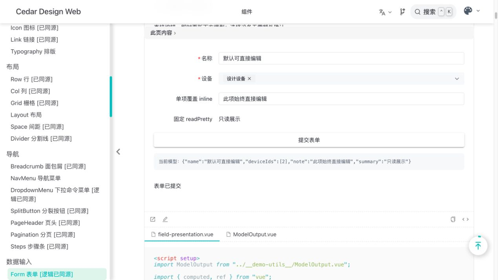
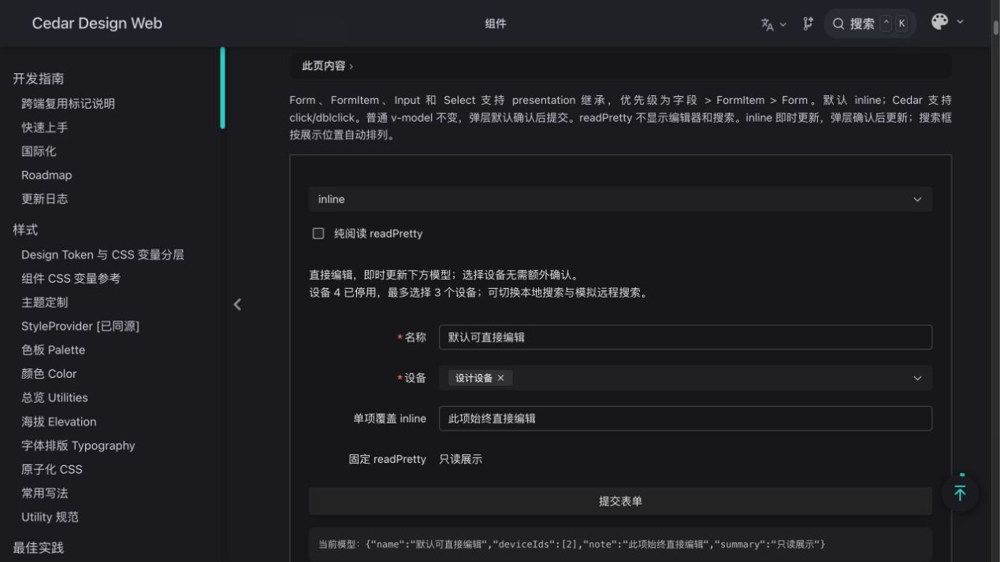

## 文档与热更新收尾（后续复验）

上一轮遗留的文档顺序、内部过程说明及 Cedar 热更新问题均已完成处理。

### 文档整理

- 统一检查 271 份用户组件文档：基础案例优先，尺寸 / 状态 / 变体随后，复杂展示和异步、生命周期案例靠后，功能调试位于 API 前。两端共有案例采用同一相对顺序，平台独有案例保留。
- 修复 organizer 遇到无 demo 说明章节、FormItem 等多章节结构就跳过整页的问题。说明文字跟随对应案例，独立章节边界保留；重复运行 changed=0。
- 修复 Button 三份文档中表格末行与“按钮组布局”标题黏连的问题，并同步 Maple 独立预览标题。
- 内部授权、交接、审计过程和测试数字移到 maintenance-notes.json；累计归档 68 页、141 段，历史可追溯。公开用法、操作步骤、必要限制和代码不按过程记录清除。
- 304 页的 demo 引用多重集与整理前一致，没有删减或重复案例。初次清理时表格快照保持不变；最终快照只有 Button 三页有差异（标题换行修复，以及工作区并行更新的 icon-container 描述 / 动效说明），已保留当前工作区变更，未回滚他人内容。

### Cedar 热更新修复

1. 实际发现 PID 8941 和 44143 分别绑定通配地址、127.0.0.1 的 9991，同时使用同一 `.temp`，已清理重复实例并以单实例服务复验。
2. 在配置加载时增加项目级进程互斥；实际重复启动已被明确拒绝，未开始生成页面。正常退出释放锁，已退出进程留下的锁可重新获取。
3. 页面临时文件改为同路径串行写入、临时文件原子替换，内容相同时不写入，避免 Vite 读到半写入的模块或重复触发更新。没有吞掉 updatePageData 异常，也没有直接修改 node_modules。
4. 补齐自动生成英文 fallback 页的热更新同步；人工维护的英文页面不被覆盖。

### 实际页面复验

- Cedar Select：基础用法位于第一项，实际选择 Guangzhou 后回填并收起；暗色卡片、源码显示正常。
- 同时修改 README 说明和 demo 的 aria-label，**未手动刷新**即看到正文、控件名称、展开源码更新；浏览器 error 日志为空。
- 切到英文 fallback 页后再次修改中文源正文和 demo，**未手动刷新**即显示“本例只演示单选”和新的“基础单选示例”；error 日志仍为空。
- Cedar Form：基础用法在前，亮色首屏无内部过程说明，表单布局可见。
- Maple Form / Select：正文和右侧独立预览顺序同步，基础案例在前；下拉选“睡觉”后回填并收起；展开源码包含实际新属性；亮暗色分别截图确认可读，检查时无 error 日志。

### 验证结果与范围

- 文档排序回归：7 项通过；Cedar 文档工具回归：16 项 / 8 文件通过（包含启动锁、原子写入、英文 fallback 同步）。
- 全量示例编译：2,852 个通过；2,853 个文档引用通过。
- 双端示例：122 对通过，包含 22 次 Markdown 转换和 11 份公共 API 表检查。
- 功能调试静态检查：550 份 SFC / 配置，以及全量 demo 和文档控件检查通过。本轮未重跑 550 个运行时场景。
- Cedar / Maple 类型检查通过；Maple 全库 lint 通过，最终修改的示例也做了定向 lint；三仓库 diff 空白检查通过。
- 排序及内部说明归档检查再次运行均无待修改项。规范已同步到 standards/demo-design.md。
- 这是文档基础设施和重点页面的复验，不等于所有组件、真机触屏、浏览器矩阵、地图 SDK 或真实上传接口的完整人工验收。

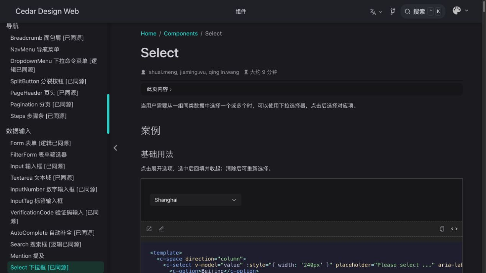
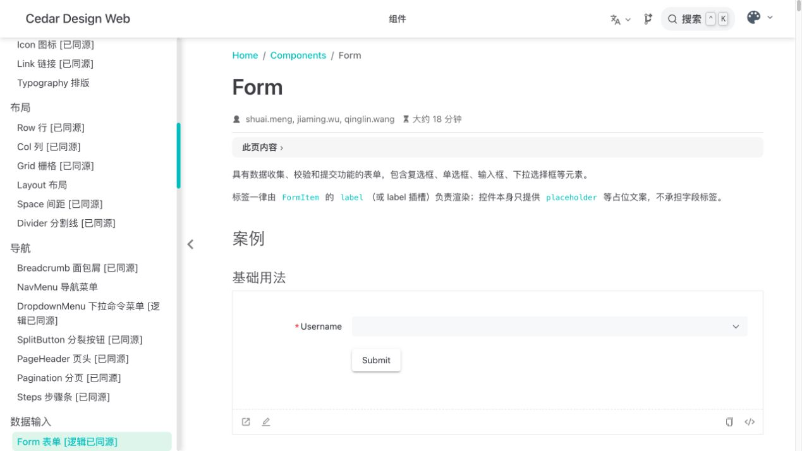
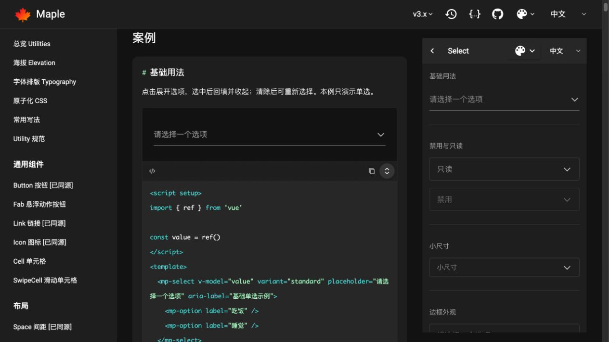
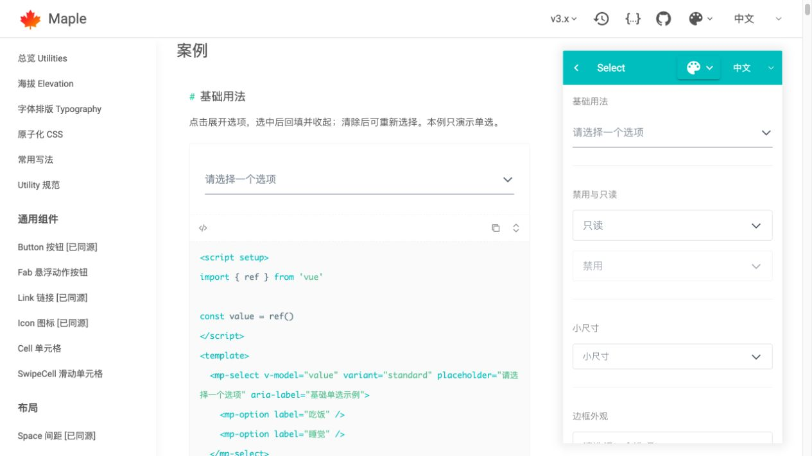

## 全页面浏览器巡检结果

本轮实际补查剩余组件页面，包含默认亮色、默认暗色、文档 demo 几何布局、Maple 独立手机预览及首例展开源码。Cedar 100 页、Maple 91 页的清单已走查；其中本轮 181 页完成亮暗观察，前轮 Button、Select、Form、Tabs 共 8 页已有实页记录，Cedar Dialog、Scheduler 两页仍未完成干净环境复验。不是所有案例交互、所有案例源码、真机或跨浏览器的全量验收，也未逐一切换另一套品牌色。

| 组件库 | 页面清单 | 本轮亮暗已查 | 前轮已查 | 本轮未完成 |
| --- | ---: | ---: | ---: | ---: |
| Cedar | 100 | 94 | 4 | 2 |
| Maple | 91 | 87 | 4 | 0 |

本轮 179 页的首例展开源码与巡检时读取的 SFC 一致。Cedar Time、DropdownMenu 两页遇到巡检期间源码／引用发生变化，保留为待稳定版本复验，不认定为源码预览组件故障。逐页的交互覆盖级别、源码状态、未完成项见 [页面巡检明细](./browser-page-coverage-2026-10-23.md)。

### 确认的问题

1. **Cedar Map 基础案例运行失败。** 浏览器抛出 `ReferenceError: base64ToString is not defined`，位置为 `src/map/__demos__/basic.vue` 的 mounted 回调。该案例的 `fetch` 也未初始化，外层 `v-if="fetch"` 使地图入口不显示；不是配置真实地图 SDK 就能直接通过。另一案例定位图仍指向占位域名，图片加载失败。演示前应先修案例依赖和缺省展示，再进行 SDK 集成验收。
2. **Maple 多个组合 demo 在窄屏下实际撑宽。** 手机预览容器宽 346px，Checkbox 异步选项滚动宽 375px、Radio 异步选项 546px、Rate 798px、Tag 521px、DropdownMenu 608px、Tooltip 445px、Icon 412px、Pagination 375px，亮暗均可复现。应让控制区和组合换行、限制长内容最小宽度；需要横向滚动的案例明确使用局部滚动容器，不撑开整个预览。Badge、TabBar、Upload、Ripple 还有局部溢出命中，需逐例确定合适布局。Row／Col gutter 检测命中但页面宽仍 346px，不算整页撑宽；InputNumber、Progress 的 1px 差异也不按大面积溢出处理。Cedar Segmented 的尺寸组合、Maple ProgressGroup 的部分组合有局部溢出待调整。
3. **Maple Checkbox 独立预览顺序和标题不统一。** 禁用／只读仍位于基础用法之前，“原生控件与外观”重复出现；Radio 也存在禁用／只读先于基础案例的情况。文档整理器的静态通过没有覆盖全部旧式 AppType 结构，应补独立预览顺序与标题对照验证。
4. **Cedar Textarea 首例说明和内容不对应。** “基础用法与值模型”讲述 `v-model`、`default-value`、`.trim`，首例主要展示变体／尺寸，并未绑定 Textarea 的值模型。展开源码与实际组件相符，但不支持说明所承诺的功能。
5. **Cedar Table 基础案例不合适且有失效属性。** `src/table/__demos__/basic.vue` 把 6 个空状态 Tabs 放在基础用法里，数据为 `[]`，不是基础数据展示；重复使用 Xs Table 标题。`default-active-key="2"` 已不在 Tabs 契约中，当前有效属性是 `default-active`，因此实际默认高亮 Lg 而不是源码意图的 Md。应将空状态分组独立，基础用法直接显示少量数据，并清除失效属性。
6. **Maple 辅助文档缺标题。** FormDetails、HighlighterProvider、LocaleProvider 没有一级标题，页面直接从功能调试／API 开始。案例能显示，但不适合无上下文直接打开。

### 环境中断和未完成项

- Maple 巡检期间反复重建 `maple-cli/lib`、`maple-use/lib`、`maple-icons-vue/es`。日志有明确的缺文件预转换错误及大量整页 reload。8082 检查服务重启恢复后，已继续补齐 Maple 页面；没有停止其他进程或覆盖并行代码。
- Cedar 本轮检查服务重启准备数据耗时约 445 秒。之后曾出现案例外框可见、内容只有 `<!---->` 的空占位；最新 Dialog、Scheduler 记录因此撤销“完成”，不是按卡片数量通过。Map 抛错后再导航出现空占位，因果关系未证实。
- 刷新进行干净复验时 9991 已无监听，检查用的 Cedar 进程已退出，退出原因未确认。没有把浏览器“拒绝连接”误记成组件 API 失败，也未反复启动重复实例。**需恢复单一稳定的 9991 服务后，重验 Dialog、Scheduler，以及 Time、DropdownMenu 的源码。**
- SwipeCell 的暗色代表性操作未完成；拖拽、签名、下拉刷新、悬停、无限滚动、上传实际网络链路、地图 SDK 等仍需专项交互验收。多数简单表单控件执行了代表性的输入／点击／键盘操作，状态变化和未断言结果分别记录，未统一标成“交互通过”。
- Image 里 `invalid-image.jpg` 为故意演示错误态，不作为缺陷。默认亮暗下的页面、卡片、源码整体配色可读，但本轮没有进行逐元素对比度计算。

### 证据和后续顺序

原始记录为 [逐次操作 JSON](./evidence/demo-reorganization-2026-10-23/all-pages/results.json)，截图、展开源码按 `库名-组件-light.png`、`-dark.png`、`-source.txt` 保存于同目录。截图为页面视口，并非每个长页面的每个案例逐屏人工截图。巡检辅助脚本通过语法检查，本轮未重跑此前全库类型检查或 550 个运行时场景，也未修改组件实现。

建议先修 Map 的运行错误和 Table 失效属性，再统一手机预览组合布局与标题顺序，随后补 Textarea 和辅助页说明。最后在不并行清理构建产物的稳定环境下完成两页阻塞复验及专项手势测试。修复任务应在当前改动稳定后执行，避免覆盖并行工作。

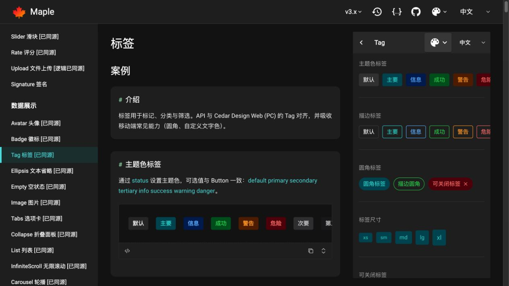
