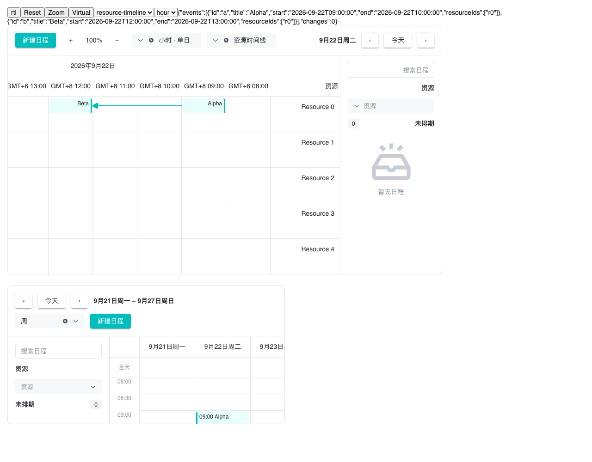

# 阅读方向 C 批：Scheduler

本批覆盖 Cedar Scheduler。沿用文档导航已有 LTR/RTL 切换；Maple 没有 Scheduler，不增加新组件或公开方向属性。

## 实现

| 范围 | 行为 |
| --- | --- |
| 统一坐标 | 私有 coordinates 模块将横向指针映射为阅读起点比例，并解析依赖关系 start/finish 的屏幕端点；日期轴保持原有时间、时区和 DST 语义 |
| 六种视图 | 月/周/日/资源日/资源时间线/列表继承局部方向；默认重叠事件、溢出入口、边框和资源固定列使用逻辑起点；纵向时间保持向下 |
| 时间线 | 事件与预览按逻辑起点定位；小时级时间线开放开始/结束拉伸，复用已有吸附、验证、里程碑、只读和 resizable 规则；日级时间线不显示拉伸柄 |
| 依赖线 | SVG 覆盖完整滚动内容，路径使用物理坐标；RTL 连接语义起止端点，方向变化重新测量 |
| 滚动与定位 | 非负阅读距离转换原生负 scrollLeft；方向切换保留距离，虚拟资源恢复和表头同步采用同一规则；切换刻度后按 startHour 定位 |
| 缩放 | 按实际轨道宽度保留可视时间区域中心的日期，等待虚拟视口重建完成再恢复；连续请求、方向变化、停用或卸载防止旧帧回写 |
| 手势与浮层 | 根时间线、事件卡片、时间网格范围选择在方向变化时取消手势；屏幕 ghost 保持物理位置并携带来源 dir；切换不写入业务日程 |
| 自定义几何 | eventLayout 的 left 保持物理左侧语义；默认布局使用逻辑起点，避免反转调用方自定义坐标 |

前后导航图形跟随方向，并隔离 Unicode 文本方向以避免二次镜像；日期前进/后退语义保持。空间方向键继续依据实际元素矩形寻找邻项。

## 验收

最终命令、计数和退出码见 [验证清单](./evidence/reading-direction-batch-c-2026-10-29/validation.json)，三引擎结果见 [浏览器结果](./evidence/reading-direction-batch-c-2026-10-29/results.json)，导航图形与方向键补充验收见 [导航结果](./evidence/reading-direction-batch-c-2026-10-29/keyboard-results.json)。

- Scheduler 全量：66 个文件、408 项通过；方向门禁：Cedar 37、Maple 15、文档导航 4，共 56 项通过。
- Scheduler 全量测试包含已有日期、时区、递归、资源、事务和生命周期回归；新增双向坐标、真实拖动吸附、方向切换取消和延迟帧释放测试。
- 方向门禁覆盖 Cedar、Maple 和共享文档导航；本批没有修改 Maple 源码。
- Cedar typecheck、全量 lint 和 API 命名检查。
- 独立生产构建夹具运行 Chromium、Firefox、WebKit；每个引擎执行 LTR → RTL → LTR，包含六种视图、局部 LTR、普通/虚拟资源、几何顺序、固定资源列、依赖线屏幕端点、移动、两端拉伸、缩放日期锚点、滚动保持、表头同步、切换取消、纵向时间拖动及刻度定位。

一次高负载并行执行触发原有递归示例的 5 秒超时；最终按原有默认超时重跑全量，408 项全部通过。

运行 `pnpm --dir design-ui check:direction:browser:c` 可单独复验。完整 `check:direction:browser` 已串接 A、B、C 三批。

## 边界与后续

本批完成核心方向契约，不等于全部主题/尺寸/自定义插槽、时区 × 递归 × 资源分组 × 编辑器的笛卡尔组合均已验收。现有领域测试通过不等于所有领域组合都做了 RTL 浏览器验收。完整发布产物和整库 quality 仍属于 P6。

下一批转入 P4 的输入族浏览器验收，优先 Input、InputNumber、InputTag、Textarea、Select；重点区分阅读顺序、原生文本光标和显式物理对齐。
