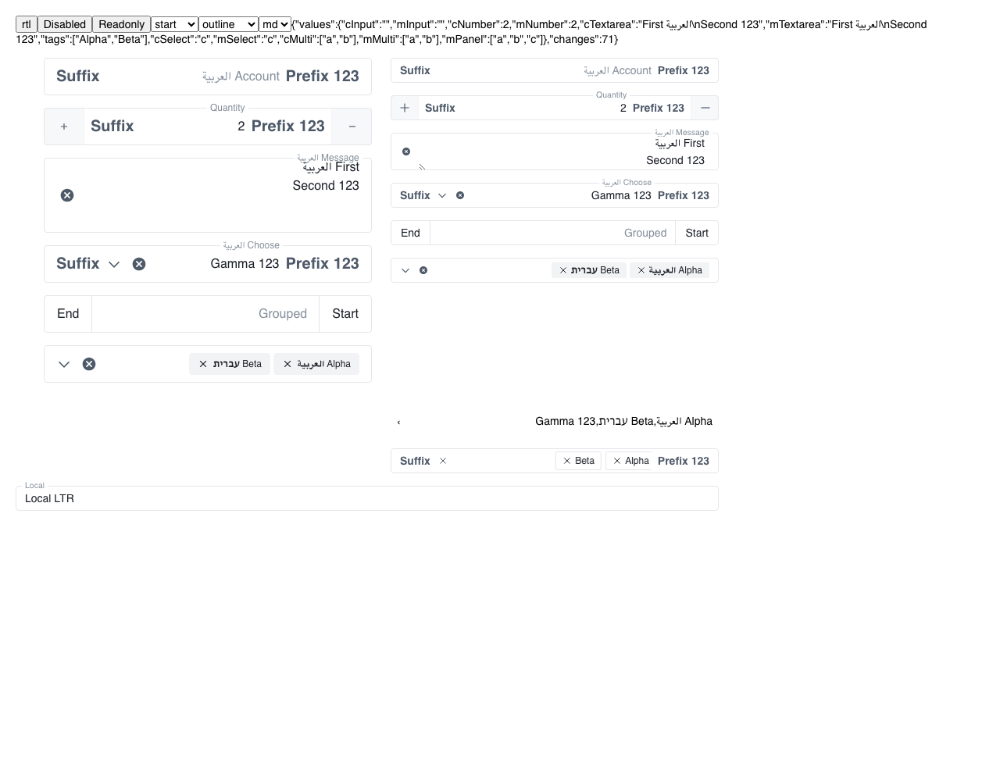

# 阅读方向 D 批：输入与选择

本批覆盖 Cedar Input、InputNumber、InputTag、Textarea、Select，以及 Maple 的 Input、InputNumber、Textarea、Select。Maple 没有独立 InputTag，保留现有多选 Select 标签能力。沿用文档导航统一切换入口，不增加公开方向属性。

## 实现

| 范围 | 行为 |
| --- | --- |
| 浮动提示 | FieldDecorator 将物理 offsetLeft 换算为内容列的阅读起点距离，placeholder 使用 inset-inline-start；缩放原点跟随方向，保证有前缀时提示与内容对齐 |
| 原生方向变化 | 两端同源 useDirection 订阅最近原生 dir；尺寸未变化时也重新测量；不依赖 ResizeObserver 意外触发来修正位置 |
| 几何生命周期 | KeepAlive 停用时断开观察器、移除 resize 监听、取消待执行帧；恢复时只绑定一次；卸载释放 |
| 选择框默认 | 独立 Select 默认 start，继承 FormItem 时保留其已有 content-align；显式 textAlign=left/right 的文字及选项排列保持物理含义 |
| 原生编辑 | 保留输入节点、焦点、选区和业务值；不交换原生左右键、不反转字符串或标签数组；数字上下键保持增减语义 |
| 复用已有能力 | 前后缀、清除操作、输入框组逻辑边角、标签添加/删除及弹层来源方向沿用现有实现，并补充生产浏览器证据 |

两端组件说明和 Select 对齐默认值说明已同步。没有新增类型枚举、公开 prop、主题 token 或 Maple 缺失组件。

## 验收结果

- Cedar：294 项通过，包括五类控件、FieldDecorator、SelectionField 和单独运行的数字输入 SSR。
- Maple：42 个文件、307 项通过，覆盖对应四类控件及共享字段层。
- 方向门禁：Cedar 40、Maple 18、文档导航 4，共 62 项通过。
- 两端 typecheck、全量 lint 与 API 命名检查：结果见验证清单。
- Chromium、Firefox、WebKit：每个引擎执行 LTR → RTL → LTR，共 9 个方向轮次；每轮覆盖两端控件。

[验证清单及日志](./evidence/reading-direction-batch-d-2026-10-29/validation.json) · [浏览器结果](./evidence/reading-direction-batch-d-2026-10-29/results.json)

生产夹具检查：前后缀真实几何位置、有前缀的浮动提示、方向切换后原生焦点与选区、Input 的组合输入协议、清除、上下键、标签添加/删除与数组顺序、Select 搜索与 Enter/Escape、显式三种物理对齐、自定义 LTR 容器中的来源方向、打开时原生 dir 更新、Maple 默认底部面板草稿确认，以及 outline/filled/standard × sm/md/lg 输入框组顺序与首尾边角。禁用、只读、外观和尺寸切换不修改业务值。

复验生产浏览器：`pnpm --dir design-ui check:direction:browser:d`。完整 `check:direction:browser` 已串接 A、B、C、D。

## 测试隔离与边界

Cedar 的旧版 Vitest 在单进程混合 node SSR 与 jsdom 时会缓存无 document 的 Vue runtime，计时器用例混跑还出现全局污染；本批按组件族分进程运行，数字输入 SSR 单独执行，不跳过用例。验证清单记录各组文件、计数和退出码。Maple 使用专用来源别名配置及单 worker。最初的混跑失败不作为通过证据。

IME 为合成 composition/input 协议验收，不宣称系统输入法或移动真机通过。原生密码模式、全部品牌主题、所有表单继承/自定义编辑器组合、SSR hydration 和完整发布产物仍属于 P6。Form 的默认与显式对齐、组布局和校验信息将与 Checkbox、Radio、Switch 一起在 E 批审查；本批没有改动 Form 的公共配置。
