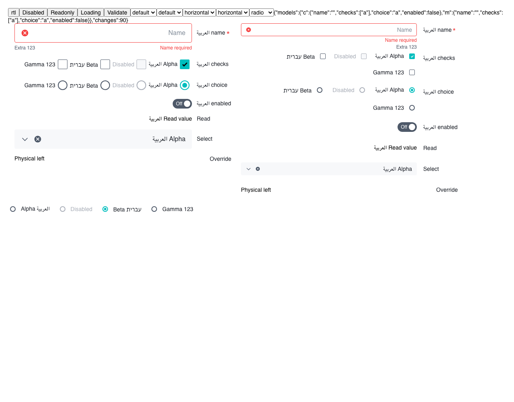

# 阅读方向 E 批：Form、Checkbox、Radio、Switch

本批覆盖 Cedar 与 Maple 已有的四个组件族。沿用文档导航统一 LTR/RTL 切换，未新增组件级方向属性。

## 实现及 API

- 两端 Form/FormItem 的 contentAlign 新增 start/end，完整枚举 start/end/left/center/right；labelAlign 新增 start/end，完整枚举 start/end/left/right。
- 默认内容对齐改为 start，水平标签默认 end。默认 LTR 布局保持原位置，RTL 默认随阅读方向排列；显式 left/right 保持物理语义，修复原来映射为 flex-start/flex-end 的不一致。
- 保持字段覆盖、Form 继承及显式标签列样式的优先级；vertical/inline 继续使用原有标签布局规则。Cedar 校验反馈图标改用逻辑终点定位；Maple FormDetails 的错误/附加信息改为 start/end，错误间距使用逻辑终点。
- Maple Radio 的横向导航原来仍使用固定左右键，现按目标元素的当前 dir 换算；普通和按钮式单选组均跳过禁用项。上下键及 Home/End 保持逻辑顺序。
- Checkbox 和 Switch 沿用已有逻辑布局和交互实现，补齐三引擎证据。Checkbox Space、Switch Space/Enter 保持操作语义；方向切换不改变业务值，禁用、只读和 loading 仍阻止提交。

两端公开类型、布局示例、中英文说明和 OpenSpec 变更已同步。未保留旧默认值兼容分支。旧应用显式传入 left/right 时仍取物理侧；需要随阅读方向对齐时使用 start/end。

## 验收

| 检查 | 结果 |
| --- | --- |
| Cedar Form / Radio / Checkbox / Switch 及组 SSR | 477 项通过 |
| Maple Form / Radio / Checkbox / Switch、组 SSR 及 FormDetails | 531 项通过 |
| 方向门禁 | Cedar 45、Maple 23、共享导航 4，共 72 项通过 |
| 两端 typecheck / 全量 lint / API 命名 | 结果见验证清单 |
| 两端 spec:check | Cedar 95、Maple 91 个检查目录，均 0 错误、0 警告；不是方向支持率 |
| 生产浏览器 | Chromium、Firefox、WebKit，均执行 LTR → RTL → LTR，9 个方向轮次通过 |

[验证清单和日志](./evidence/reading-direction-batch-e-2026-10-29/validation.json) · [浏览器结果](./evidence/reading-direction-batch-e-2026-10-29/results.json)

浏览器检查两端默认/显式内容与标签的实际几何对齐、字段覆盖、三种 Form 布局切换、两端真实校验错误保持、单选跳过禁用项与 Home/End/方向键、普通及按钮式单选、水平与垂直组、Checkbox Space、Switch 手柄实际运动和键盘、禁用/只读/loading、局部 LTR。校验规则按两端各自公开契约配置，分别确认两端都有错误后再切换方向。

旧版 Cedar Vitest 的跨族模拟焦点/计时器用例存在污染，最终按组件族独立进程复验，SSR 组单独运行，不跳过用例。Maple 原有 Form 快照只更新默认内容对齐片段，保留原有条目。

复验：`pnpm --dir design-ui check:direction:browser:e`。整体浏览器方向门禁已串接 A—E 批。

## 后续范围

本批为核心方向契约验收，不等于全部品牌主题、尺寸和 Switch 外观、自定义标签/校验插槽、异步事务组合、原生移动真机、SSR hydration 或整库发布产物均已验收。它们继续留在 P6。

下一批为 Cascader、TreeSelect、AutoComplete，检查层级展开、搜索/标签、方向键与跨容器定位；Maple 只覆盖现有 Cascader、AutoComplete，不增加缺失的 TreeSelect。
