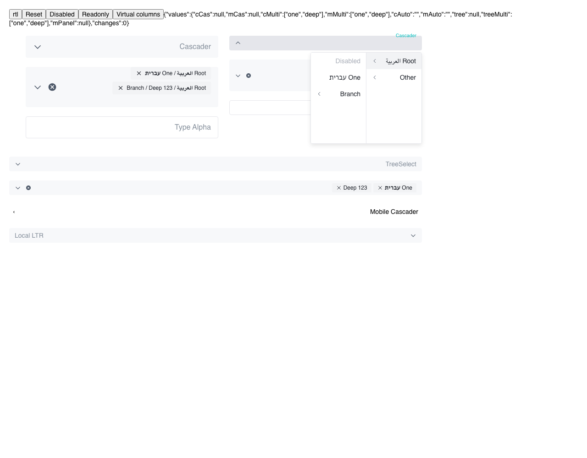

# 阅读方向 F 批：Cascader、TreeSelect、AutoComplete

本批覆盖 Cedar Cascader、TreeSelect、AutoComplete，以及 Maple 已有 Cascader、AutoComplete。额外修复两端 Input 的组合输入缓冲问题；不新增 Maple 缺失的 TreeSelect，不增加公开方向 prop。

## 实现

| 范围 | 行为 |
| --- | --- |
| 层级方向 | 两端 Cascader 按键盘事件目标的当前 dir，将左右键解释为进入已加载子级/返回父级；不改写原始事件，不反转路径和多选数组 |
| 禁用与编辑 | 进入子级跳过禁用项；搜索输入的左右键继续交给原生编辑器，组合期间不触发选择 |
| 可视布局 | 子列沿阅读方向排列，分隔线使用逻辑终点，展开 SVG 单独跟随方向；文字不整体镜像 |
| 清空重开 | 已关闭 Cascader 的最后一个有效值清空后，同步清理旧活动项和路径，避免重开继续落在旧子级 |
| TreeSelect | 沿用已有面板方向处理，补充 LTR/RTL 的展开、进入、返回父级、折叠和动态切换契约；验证搜索活动项、单选、复选与标签操作 |
| AutoComplete | 左右键与同方向原生 input 对照；上下键/Enter/Escape、搜索、跨容器方向、组合输入提交补齐生产浏览器证据 |
| Input 依赖修复 | 候选变化重绘时，组合中的原生 DOM 文本不再被旧模型值覆盖；旧选区恢复任务在新的组合期间不回写，组合结束后按原流程提交 |
| Maple 面板 | 默认移动面板继承来源方向；选择先更新草稿，确认后才提交完整路径 |

没有增加公开 API 枚举、兼容别名或主题 token。Cascader 对齐说明同步为共享字段层已有的 standalone start 语义。

## 验收

| 检查 | 结果 |
| --- | --- |
| Cedar Cascader / TreeSelect / AutoComplete / Input | 202 项通过，其中 Input 依赖回归 86 项 |
| Maple Cascader / AutoComplete / Input | 196 项通过，其中 Input 依赖回归 102 项 |
| 方向门禁 | Cedar 54、Maple 30、共享导航 4，共 88 项通过 |
| 两端 typecheck / 全量 lint / API 命名检查 | 通过 |
| 生产浏览器 | Chromium、Firefox、WebKit；每个引擎 LTR → RTL → LTR，共 9 个方向轮次通过 |

[验证清单与日志](./evidence/reading-direction-batch-f-2026-10-30/validation.json) · [浏览器结果](./evidence/reading-direction-batch-f-2026-10-30/results.json)

生产夹具检查普通/虚拟 Cascader 列的真实几何顺序、分隔线、展开图形、子级/父级键与动态 dir、禁用项跳过、路径顺序、选择后清空重开、多选标签删除和搜索恢复；TreeSelect 的层级与搜索活动项、复选标签；AutoComplete 的原生光标对照、候选选择和组合事件；自定义 LTR 挂载容器中的来源方向、局部 LTR、禁用/只读，以及 Maple 移动面板草稿确认。

额外的候选更新单测复现了原先会把组合文本覆盖为 draft 的缺陷；修复后两端通过，并覆盖旧选区任务晚于下一次组合的边界。合成 composition/input 协议测试不等于系统输入法或移动真机验收。

Cedar 旧版 Vitest 用明确文件列表、按组件族分进程执行，避免路径过滤 src/input 误收集 InputNumber 的 node SSR，以及跨组件计时器/焦点模拟污染。最初的夹具配置和混跑失败不作为通过证据，验证清单记录最终文件与退出码。

复验：`pnpm --dir design-ui check:direction:browser:f`。完整方向浏览器命令已串接 A—F 批。静态截图禁用过渡动画，避免将中间帧作为视觉证据。

## 后续范围

核心契约通过不等于全部变体均已验收。懒加载/远程请求与方向、停用、主题及自定义插槽的完整组合，TreeSelect 大规模虚拟树、原生 IME、SSR hydration 和发布产物仍属于 P6。

下一批为两端 Date/DatePicker、Time、TimeRange：日期与范围语义、时间列、快捷项、键盘和弹层方向；时间值不因 RTL 而反转。
