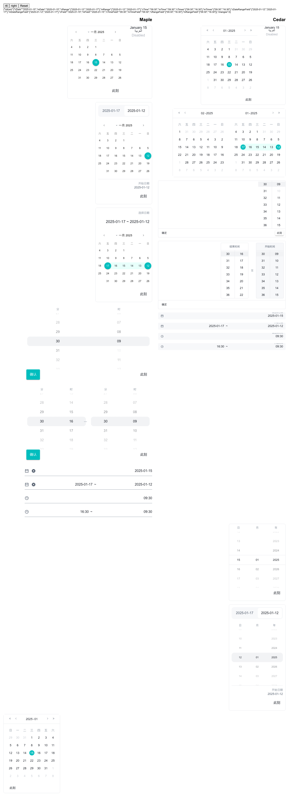
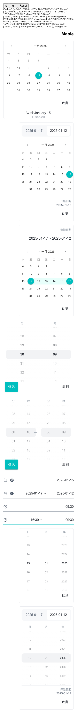

# 阅读方向 G 批：日期、日期范围与时间

本批覆盖两端 Date/DatePicker、Time、TimeRange，并追加验证共享日期面板服务的 DateRange/DateRangePicker。沿用导航统一切换与原生 dir 契约，没有新增组件级方向 prop 或公开枚举。

## 实现

| 范围 | 行为 |
| --- | --- |
| 日期网格 | 分页日/月/年网格按当前事件目标的方向处理左右键；上下键移动一行，Home/End 移到行首尾，跳过禁用项，焦点不提交值；边界停留在当前显示网格 |
| 日期视觉 | 前后翻页 SVG 与 Maple 翻页过渡跟随方向；日期范围高亮半线、实际/预览起止圆角、周范围边界及分隔线使用逻辑属性 |
| 时间列 | 左右键沿视觉方向切换列，并覆盖 TimeRange 起止分界；Cedar 上下键与 Home/End 移动焦点，Enter/Space 选值；Maple 保留滚轮原有垂直选值规则 |
| 移动日期滚轮 | 日期与范围的列间左右键使用同一方向转换，单独覆盖分页日历与日期滚轮入口 |
| 快捷区 | 显式 left/right 保持物理侧；内容继承阅读方向，底部快捷项间距使用逻辑属性 |
| 领域值 | 日期、时间、起止数组和跨日语义不反转；仅切换 dir 不触发选值、确认或模型更新 |
| 字段与弹层 | 默认文字逻辑起点对齐；自定义 LTR 挂载容器中的弹层继承来源方向，保留现有草稿与确认事务 |

Maple 的公开范围面板使用端点编辑；连续范围高亮另外走内部共享日历展示路径，夹具分别验收这两种行为。两端私有键盘辅助实现保持同源，并加入方向门禁的源码一致性检查。文档已同步两端中英文说明与现有 Picker 页面。

## 验收

| 检查 | 结果 |
| --- | --- |
| Cedar Date / DateRange / Time / TimeRange（含日期 SSR） | 449 项通过 |
| Maple 对应四族（含日期 SSR） | 1018 项通过 |
| 方向门禁 | Cedar 62、Maple 38、共享导航 4，共 104 项通过 |
| 两端 typecheck / 全量 lint / API 命名检查 | 通过 |
| 生产浏览器 | Chromium、Firefox、WebKit；9 个桌面方向轮次与 6 个 Maple 窄屏方向场景通过 |

受影响组件按明确文件列表、DOM/SSR 分进程执行；最终运行文件、命令、日志与退出码均已归档。范围预览叠加状态另外断言先清除另一侧圆角，避免逻辑属性迁移后保留旧边界。

生产夹具以两端源码构建正式模式页面，在 Chromium、Firefox、WebKit 中各检查 LTR → RTL → LTR，另在 375×812 视口检查 Maple 的 LTR 与 RTL，共 15 个引擎/方向/视口场景。验证日期网格实际几何、翻页图形、范围高亮逻辑边界、时间列与起止面板顺序、动态 dir 后焦点移动、禁用小时跳过、Enter 选日期、时间确认前后模型、局部 LTR、显式快捷区物理位置和四类字段跨容器弹层。窄屏弹层额外断言没有超出视口。

[验证清单与日志](./evidence/reading-direction-batch-g-2026-10-30/validation.json) · [浏览器结果](./evidence/reading-direction-batch-g-2026-10-30/results.json)

复验：`pnpm --dir design-ui check:direction:browser:g`；方向浏览器总命令已串接 A—G 批。截图关闭动画后保存，避免将过渡中间帧作为视觉证据。

## 验收边界与后续

本批为核心方向契约验收；完整的日历 scroll/line 虚拟化、所有日期精度与日期时间布局、时区/DST/跨日规则和方向的组合、自定义渲染/主题/容器、SSR hydration、原生移动设备与发布产物仍归 P6。已有相关日期/范围/时间回归已执行，但不能据此将上述组合或整库全部标为通过。键盘焦点停留在可见网格边界，本批未增加跨月方向键导航。

最初的快照差异通过复用原有 role=option 消除；原生按钮键盘默认点击在真实浏览器验证，单测使用对应点击事件；过渡完成与 CSS 计算长度使用实际渲染结果断言。修正夹具前的失败不作为通过证据，validation.json 仅记录最终运行。

下一批为两端 Button（含已有分组）、SplitButton、Space、Divider：按钮组合、前后图形、分隔线、逻辑间距与嵌套切换。此次未发布、推送或部署。
