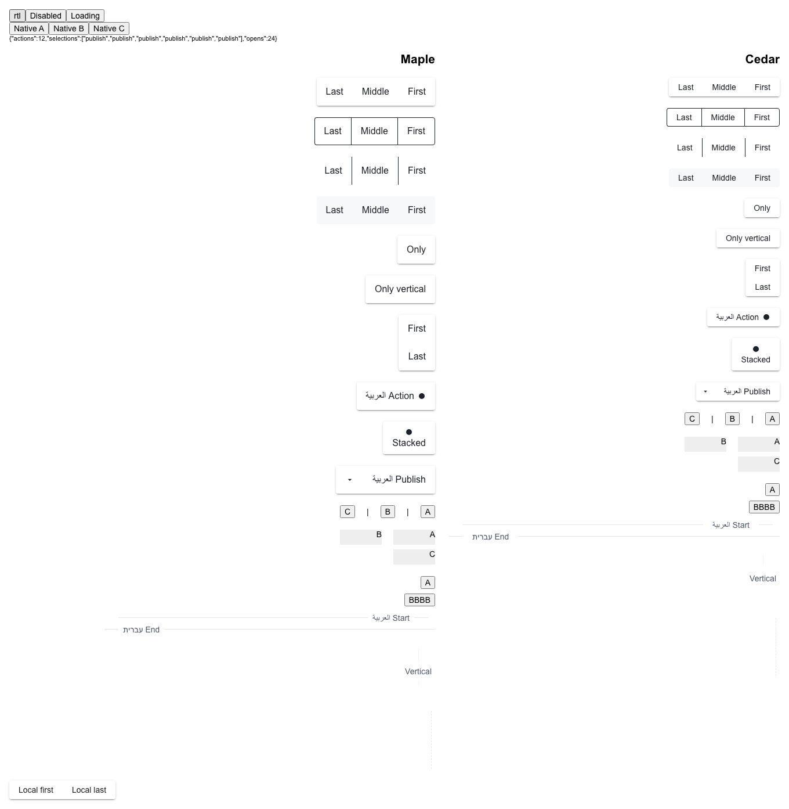
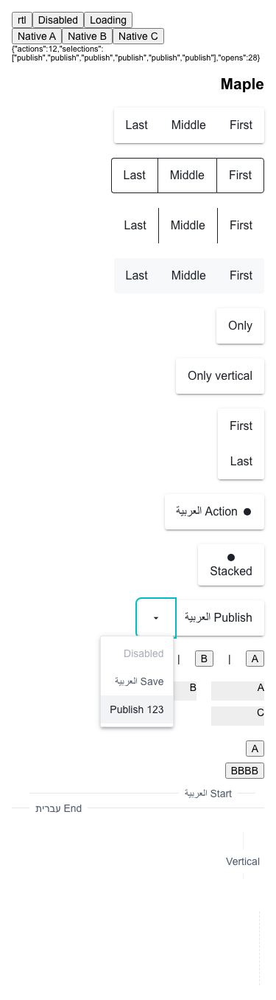

# 阅读方向 H 批：按钮组合、Space 与 Divider

本批覆盖两端 Button（含 ButtonGroup）、SplitButton、Space、Divider，沿用已有导航方向按钮，不增加公开方向 prop 或普通按钮组的左右键语义。

## 实现

| 范围 | 行为 |
| --- | --- |
| 按钮组边界 | 横向拼接边框、text 分隔线与首尾圆角使用组方向决定的物理边界，子按钮可以拥有独立的文字方向；防止子项 dir 改变组轮廓 |
| 单个按钮 | 单子项保留完整圆角，修复同时命中 first/last 导致圆角消失的问题；覆盖水平与垂直组 |
| Button | 复用已有 flex 图标/内容顺序、加载与禁用实现；不镜像插槽图形，stacked 保持上下顺序 |
| SplitButton | 复用已有 Menu/Trigger 来源方向、逻辑对齐和原生按键；主动作与菜单动作独立，菜单跳过禁用项，选择/关闭后归还焦点 |
| Space | 已有原生 flex/gap 满足方向契约；补充 row/column、换行、split 插槽、逻辑对齐、局部方向及动态切换证据，保持子项与数据顺序 |
| Divider | 竖线边框改为逻辑起点；沿用水平 start/end 文字对齐、非对称 inset/spacing、竖向上/下含义与 hairline 行为 |

按钮组在显式父方向作用域内使用物理 CSS，是为固定组坐标；其他布局仍由原生继承和逻辑属性处理。两端中英文文档、阅读方向标准、逐组件矩阵与规划同步更新。

## 验收

| 检查 | 结果 |
| --- | --- |
| Cedar 四个组件族回归 | 131 项通过 |
| Maple 四个组件族回归 | 186 项通过 |
| 方向门禁 | Cedar 69、Maple 45、共享导航 4，共 118 项通过 |
| 两端 typecheck / API 命名检查 | 通过 |
| Cedar 全量 lint、两端本批范围 lint | 通过 |
| Maple 全量 lint | 未通过：本批未修改的其他组件报告 29 项格式/大括号错误 |
| 生产浏览器 | 三引擎 9 个桌面方向轮次与 6 个 Maple 窄屏场景通过 |

Maple 全量 lint 的错误位于 Dialog、SwipeCell、TabBar、Table、Upload 等当前工作区文件。本批未修改这些文件，未执行整库自动修复；不能据此声称整库检查通过。完整失败日志与本批范围 lint 的通过结果均已归档。最终测试以原生 DOM 属性切换 dir，并在修正后重新运行全部受影响家族与方向门禁。

生产夹具覆盖 Chromium、Firefox、WebKit 的 LTR → RTL → LTR，以及 375×812 Maple 的 LTR/RTL，共 15 个方向/引擎/视口场景。验证四种按钮变体的首尾圆角、单子项完整轮廓、子按钮分别显式 LTR/RTL 时的拼接边框、垂直顺序、图标与内容、加载/禁用；Space 的换行行距、列布局对齐与 split；Divider 的文字位置、非对称逻辑边距、竖线与无障碍朝向；SplitButton 的原生 Enter/Space、上下键打开、跳过禁用项、End/Enter、Escape、焦点归还、动态方向不产生业务事件，以及 LTR 自定义容器中的来源方向和窄屏弹层边界。

Tab 使用同引擎、同页面的原生按钮对照：Chromium/Firefox 为 Tab，当前 macOS WebKit 为 Alt+Tab 全键盘访问模式。组件不修改浏览器平台偏好。方向切换后的圆角断言等待原有过渡完成；初次读到中间帧的失败不作为通过证据。原生 dir 测试直接更新 DOM 属性，不把 dir 伪装成组件公开 prop。

[验证清单与日志](./evidence/reading-direction-batch-h-2026-10-30/validation.json) · [浏览器结果](./evidence/reading-direction-batch-h-2026-10-30/results.json)

复验：`pnpm --dir design-ui check:direction:browser:h`；总方向浏览器入口已串接 A—H 批。

## 边界与后续

核心方向通过不代表整库 quality、全部主题/状态/插槽/复杂嵌套组合、SSR hydration、原生移动设备或发布产物验收完成，这些仍属 P6。本批没有修改主题配色或增加 toolbar/roving tabindex 模型；SplitButton 完整递归子菜单组合继续归 Menu 专项覆盖。

下一批为两端 Breadcrumb、Pagination、Link：路径分隔、页码前后图形、键盘与原生链接行为。此次未发布、推送或部署。
