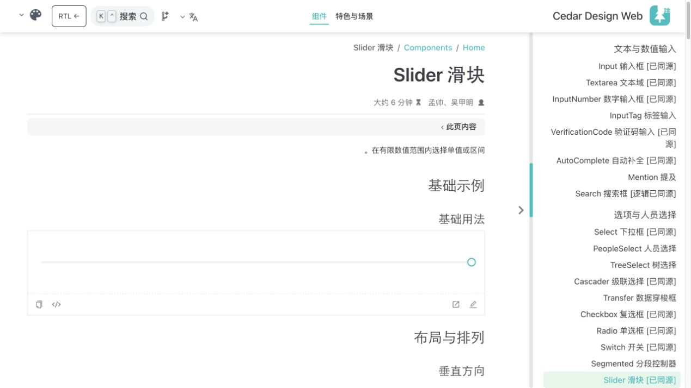
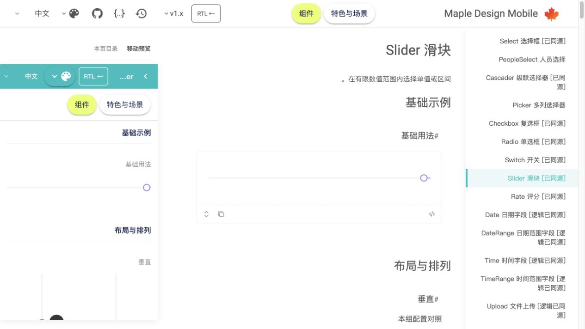

> 本文保留初始审查/阶段实现记录；当前状态见 [全量收尾](direction-closeout-2026-10-30.md) 与更新后的逐项清单。

# LTR RTL 双向布局实施记录

公共方向能力、文档导航切换和首批组件适配已实现。整体采用原生 dir、统一方向 composable、逻辑 CSS 和按组件处理的交互规则。全库 194 个原审查目录或基础设施项的后续工作已登记；这些目录的完整双向视觉验收尚未全部完成。

实施顺序与剩余交付条件见 [实施计划](../refactors/reading-direction-plan.md)，逐项进度见 [实现清单 JSON](./direction-implementation-inventory-2026-10-29.json)，基础契约见 [阅读方向规范](../standards/reading-direction.md)。

## 已实现的能力

| 范围 | 实现 |
| --- | --- |
| 两端 use 包 | 同源 useDirection、provideDirection、ReadingDirection；最近原生 dir、明确覆盖、SSR 上下文、动态更新、每文档共享观察器与生命周期清理 |
| Cedar ConfigProvider | rtl 布尔配置收敛为 dir；提供方向上下文，使用 display contents 的 div 传递原生方向。省略 dir 的嵌套作用域不会覆盖更近的原生 dir |
| Maple LocaleProvider | 新增独立于 locale 的 dir；省略时由原生 DOM 继承；为 SSR 和行为组件提供上下文 |
| 文档导航 | 两端共用 DirectionToggle，显示当前 LTR/RTL，键盘可操作，保存选择，刷新恢复；PC、手机文档和 iframe 通过存储与校验来源的消息同步 |
| Slider | 轨道位置、范围填充、标记、指针比例和水平键盘方向一致；垂直轴保持原有增减方向 |
| Rate | RTL 半星命中、半星图形、间距与水平键盘适配；自定义字符插槽保留内容语义 |
| Carousel | 翻页键、拖动符号、轨道运动、循环项平移、前后箭头位置与图标适配 |
| Tabs | 统一方向解析，保留键盘、滑动和滚动规则，滚动箭头随水平阅读方向变化 |
| Tag Badge Calendar | Tag 使用原生 dir 选择器修正间距；Badge 使用原生继承并保留物理角落；Cedar Calendar 接通已有 RTL 样式 |
| Menu Radio | 水平键盘方向；子菜单打开与返回方向，以及子菜单展开侧 |
| Trigger | top/bottom 的 start/end 使用逻辑对齐，物理侧保持；动画原点同步；外部挂载的 popup 写入来源 dir，方向变化后重新定位 |
| 其他 Portal | Dialog、Drawer、Popup、Overlay、Message、BackTop、FloatingPanel、Drag 传递来源方向；Cedar 字段编辑浮层传递 dir 并按阅读起点对齐 |
| 展示与输入布局 | 首批组件改用逻辑间距及分组边框，列偏移改为逻辑起点；物理位置 API 与 token 名称保持其已有边界 |
| 滚动条与表格 | 处理负 scrollLeft 与 overscroll；滚动条滑块按物理坐标工作并转换回原生坐标；表格边界、列宽调整、调整手柄及缩进适配 |

代码、照片、地图、签名和明确的物理 left/right 方位不整体镜像。方向与 locale 分别配置。外部原生容器的方向在客户端从 DOM 解析；SSR 需要显式方向上下文来保证首屏行为与布局一致。

## 使用方式

```vue
<c-config-provider dir="rtl">
  <c-slider :default-value="30" />
  <div dir="ltr">
    <c-slider :default-value="30" />
  </div>
</c-config-provider>

<mp-locale-provider dir="rtl">
  <mp-slider :default-value="30" />
</mp-locale-provider>
```

原 ConfigProvider 的 `:rtl="isRtl"` 改为 `:dir="isRtl ? 'rtl' : 'ltr'"`。ConfigProvider 现在有一个不生成布局盒子的 div；应放在允许 div 的 HTML 上下文中。DialogConfig、Trigger 及模态基础组件的方向选项也使用 dir；例如函数式调用可以显式传入 `Dialog.open({ title: '确认', dir: 'rtl' })`。

## 验证结果

以下结果针对本轮修改及相关回归，不代表全库每个组件的 RTL 视觉认证。

| 检查 | 结果 |
| --- | --- |
| design-ui 的 pnpm check:direction | 25 条通过：Cedar 11、Maple 10、文档控件 4；两端 composable 同源检查通过 |
| Cedar Scrollbar | 75 条通过，含公开入口、旧目录副本及停用、卸载、重入回归 |
| Maple selection scrollbar | 37 条通过 |
| Cedar 模态及反馈组件 | DOM 测试 100 条通过；Node 环境 SSR 测试另行运行，2 条通过 |
| Maple 模态及反馈组件 | 24 个文件、173 条通过 |
| Cedar Tabs | 36 条通过 |
| 类型 | Cedar 声明类型检查、Maple 根目录 typecheck 的两套配置均通过 |
| use 包构建 | 两端 ESM、CJS、声明文件构建通过 |
| 样式 | 42 个相关 Less 文件编译通过 |
| 基础设施同源 | 68 个运行时基础模块对通过；Carousel 12 对源码、样式和测试文件同源检查通过 |
| 命名门禁 | 72 个声明文件、93 项已登记属性，0 错误 |
| lint | Cedar 全范围通过；Maple 本轮修改文件及新增配置单独检查通过 |
| 浏览器 | Cedar 和 Maple 导航切换、RTL 水平 Slider 左键增值、Maple 手机预览同步和刷新保留状态已验证 |

`check:direction` 已接入两端 quality 和 design-ui check。Maple 的专用测试配置将 use 包解析到源码，避免旧构建产物影响方向验收。Cedar 的测试配置关闭原生 fsevents 后端，避免旧版测试器在新 Node 环境退出时出现原生清理异常。Cedar 的 Node 环境 SSR 与 DOM 回归分进程验证，避免旧版测试器跨环境复用 DOM 模块缓存。

快照更新核对为方向属性变化；ConfigProvider 的快照另外体现新增方向作用域容器。Maple Dialog 的一个旧断言仍按字符串检查 beforeClose payload，已同步到现有 `{ action: 'close' }` 契约。

Maple 全量 lint 的首次执行还包含 docs practices examples、CLI vite.config 和 release.mjs 等本次修改范围之外的格式问题，因此没有将全量 Maple lint 或整库 quality 标记为通过。Slider、Rate、Tabs 的旧同源门禁仍停在 props 的源码归一化差异；这些公共 props 未在本轮方向改造中修改，保留在整库收尾范围，不据此推断运行时行为差异。

完整通过日志和检查范围见 [验证记录](./evidence/reading-direction-2026-10-29/validation.json)。

浏览器证据：





## 剩余范围

Steps、Timeline、NavMenu、Tree、Transfer 的后续 A 批适配与核心交互验收已完成，见 [A 批记录](./direction-batch-a-2026-10-29.md)。B 批 Split/ResizeBox/Table 与虚拟滚动的核心专项也已完成，见 [B 批记录](./direction-batch-b-2026-10-29.md)。C 批 Scheduler 的领域坐标、移动、两端拉伸、缩放、定位与虚拟滚动专项已实现，见 [C 批记录](./direction-batch-c-2026-10-29.md)。D 批 Input、InputNumber、InputTag、Textarea、Select 及两端共享字段层核心方向验收已完成，见 [D 批记录](./direction-batch-d-2026-10-29.md)。E 批 Form、Checkbox、Radio、Switch 的核心方向验收已完成，见 [E 批记录](./direction-batch-e-2026-10-29.md)。F 批 Cascader、TreeSelect、AutoComplete 的层级、搜索和组合输入核心验收已完成，见 [F 批记录](./direction-batch-f-2026-10-30.md)。其他组件还需补齐各变体、局部覆盖、自定义插槽、跨容器和运行时切换证据。现有逐项清单明确保留这些验收状态。

本轮完成的是统一基础能力与首批实现。生产发布包构建、完整文档生产构建、整库 quality 和全部组件 RTL 浏览器验收属于后续收尾条件。
