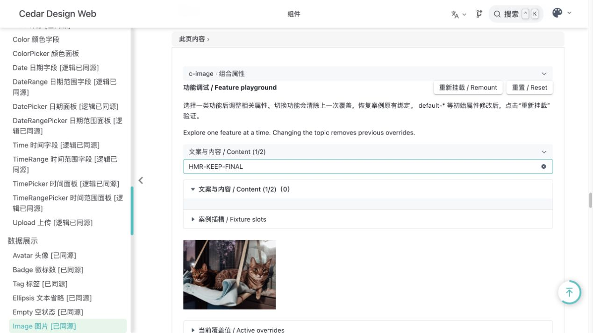
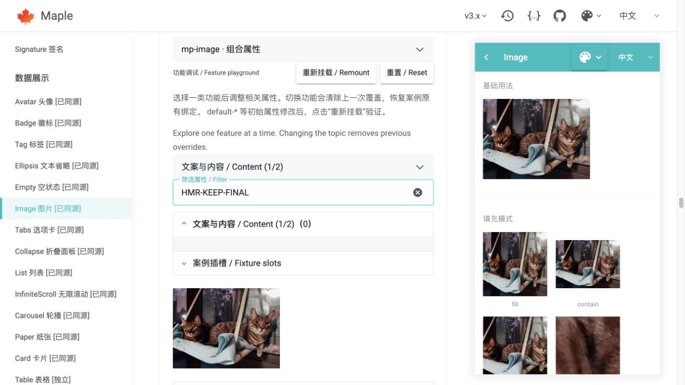

# Image / Upload 原生热更新修复

日期：2026-10-23，最终浏览器短窗口复验：23:21（Asia/Shanghai）。

后续全库检查：已进一步拆除 Menu / Scheduler 模块环，并把 2,104 个源码模块的依赖与 HMR 兜底检查接入两库 CI。详见 [全库运行时依赖复查](./runtime-dependencies-2026-10-23.md)。

## 结论

Cedar / Maple 均已删除 Image、Upload 的 `handleHotUpdate → full-reload` 兜底，恢复 Vue / Vite 原生局部 HMR。没有用延迟导入、捕获初始化错误、忽略异常或手写 HMR accept 掩盖循环依赖。

两端分别实际修改并恢复了 Upload、Image、ImagePreview、ImagePreviewGroup 的模板与脚本。打开状态的预览组也完成更新。16 个“组件 × 变更类型 × 组件库”组合通过：新 DOM 标记出现、外层页面输入值仍在、无初始化错误。所有临时标记均已移除；最后再执行模板修改及源码恢复，两端外层状态仍保留。

## 依赖为什么回流

旧文档配置让组件库内部 Vue / TypeScript 也参与站点自动组件和函数导入。预览实现可能因此被编译插件注入 Image 的公共入口，形成实现回到安装聚合入口的回流；聚合入口及字段包装器又要立即读取 SFC，产生 `Base` / `ImagePreviewGroup` / `previewImage` 尚未初始化的错误。

只读原始 TS 的 import 列表不足以发现这类编译注入。上一轮通过整页刷新回避局部替换，不能视为问题已彻底修复，本报告取代该方案。

## 统一后的方向

```text
Image 公共入口 ──→ Image / Preview / PreviewGroup 原始 SFC
             └─→ 预览服务 ──→ Preview / PreviewGroup 原始 SFC
Upload 公共入口 → 字段展示包装 → Upload 原始 SFC → 预览服务
```

- 公共入口负责安装、静态成员和公开导出；内部实现不反向导入本组件聚合入口或组件库根入口。
- Maple Image 入口直接引用预览 SFC，和 Cedar 一致，不再从服务模块中转组件导出。
- 双端预览服务只导出函数和类型，不再兼任 Preview / PreviewGroup 组件导出入口。公开组件库 API 保持不变。
- 双端 Upload 直接引用预览服务，预览类型使用独立模块的 `import type`。
- 文档自动导入排除内部 Vue / TS，包括 `/@fs` 与 SFC query 路径；示例、`__demos__`、文档及站点仍可自动导入。组件解析与函数解析使用相同边界。
- 两端站点导入插件不再拦截组件 HMR。回归测试约束不存在该钩子，并检查两种自动导入配置都使用实现边界。

`design-ui/standards/component-anatomy.md` 已增加上述公共契约。

## 防回归与检查结果

| 检查 | 结果 |
| --- | --- |
| Image / Upload 传递运行时依赖 | Cedar 95、Maple 91 个模块，无环路、无包根入口回流 |
| 环路检查器正反例 | 能检出模拟的 public barrel 回边；共享依赖不误报；类型引用不当作运行时边 |
| Maple Image / Upload | 22 文件、217 项通过 |
| Cedar Image / Upload | 16 文件、127 项通过；队列示例后续调整的 5 项再次通过 |
| Maple 站点解析 / 入口检查 | 11 项通过 |
| Cedar 站点解析检查 | 3 项通过 |
| Foundation 运行时依赖图 / 同源检查器 | 7 项通过 |
| 本轮专项单测合计 | 365 项通过，重跑不重复累计 |
| Upload 同源门禁 | 20 对 SFC / Props / 类型 / 样式 / 测试 / 示例通过 |
| 全库类型检查 | Cedar / Maple 通过 |
| Maple 全库 lint | 通过；首次仅检查器测试文件排版问题，修正后重跑 |
| 浏览器 HMR | 16 个有效组合通过，另补最终模板修改及恢复复验 |

新增依赖图测试接入 `pnpm check:media-core`，在 Vue 脚本编译、TS 类型擦除后检查相关源码闭包的运行时边。该检查范围不包含第三方包内部依赖，不宣称整个 monorepo 零循环。

本轮同时补齐 Cedar 队列 demo 对合成 Blob URL 的创建和卸载释放，与 Maple 对齐；测试按 aria-label 找取消／重试，不再因为新增预览按钮误点第一个按钮。同源检查器修复空 `return;` 与 `return` 的格式误报，保留返回值及清理顺序的严格比较；替换校验示例清理了实际渲染文本中的多余空白。

## 真实热更新怎么验

1. 页面外层功能调试输入 `HMR-KEEP-*`；该状态不属于被修改的组件。
2. 临时给实际组件加 DOM 标记，分别改变模板和脚本中的值。
3. 等待新 DOM 值出现，同时核对外层输入值未丢失；不以日志显示 hot update 或刷新后能打开替代。
4. 预览组打开时更新 Preview / PreviewGroup，再验证上一张切换和 Enter 关闭。
5. 恢复源码，确认标记消失、外层值仍在、控制台无 error。

证据：[native-hmr.json](./evidence/image-upload-native-hmr-2026-10-23/native-hmr.json)。包含原始尝试、有效检查、客户端日志和最后源码恢复状态。最初的提前读值／受干扰尝试保留，不改写成成功。




## 遇到的干扰及边界

- 按用户选择，没有暂停其他任务。Maple shared/utils 的并行修改曾触发 Vite 正常全页重载，最初一次状态标记丢失不计通过。23:06–23:10 的组件 HMR 窗口完成后，23:19 的 `themes/dark/badge.ts` 修改再次触发全局重载；随后 23:21 又完成模板修改、恢复及状态保留复验。这不是恢复 Image/Upload 的强刷兜底。
- Cedar 旧 Vitest 在 `--threads=false` 合并套件运行时出现全局定时器污染，SSR 测试报 `setTimeout is not a function`。使用项目默认的线程隔离、将 worker 限制为 1 后，完整 127 项通过；没有删除 SSR 断言或跳过测试。
- Vue 原生脚本 HMR 可以重建受影响组件实例；保证的是未整页刷新，不承诺组件内部临时状态在任意脚本修改后都保留。页面外层状态及受控预览操作已实际验证。
- 该结论针对本轮 Image / Upload 依赖闭包及热更新，不包含真实业务上传接口、真机或全浏览器矩阵。后续并行改动需重跑相应门禁，不能据本轮截图声称未来状态已验收。

复跑命令：

```sh
# design-ui
node --test bin/media-runtime-graph.test.mjs bin/upload-core-check.test.mjs
node bin/upload-core-check.mjs

# maple-design-mobile
node --test scripts/quality/site-resolver.test.mjs scripts/quality/library-entry-cycle.test.mjs
pnpm --dir packages/maple-ui exec vitest run --config ../maple-cli/lib/node/config/vitest.config.js src/image src/upload --maxWorkers=1 --minWorkers=1
pnpm --filter @maplejs/maple-ui typecheck
pnpm lint:check

# cedar-design-web/packages/cedar-ui
VITEST_MAX_THREADS=1 VITEST_MIN_THREADS=1 pnpm exec vitest run src/image src/upload
pnpm exec vitest run --config site-imports.vitest.config.ts --threads=false
pnpm typecheck
```
